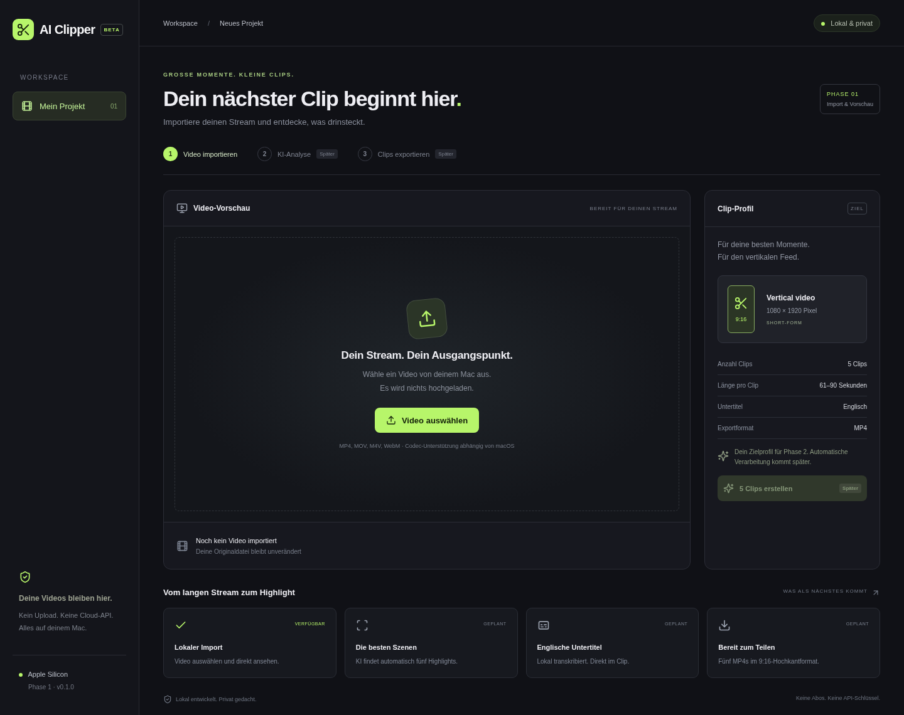

# Prüfbericht · Phase 1

Stand: 5. November 2026. Entwicklung und Befehle ausschließlich in Codex Cloud (Debian Linux x86_64).

| Prüfung | Ergebnis |
| --- | --- |
| Unit-Tests (`npm test`) | 5 erfolgreich |
| TypeScript + Produktionsbuild (`npm run build`) | Erfolgreich |
| Browser-Integrationstests | 2 erfolgreich mit vorinstalliertem Chromium |
| Echte Videowiedergabe | Erfolgreich, H.264/AAC-Testvideo |
| Import, Metadaten, erneuter Import, Entfernen | Erfolgreich im Browser |
| Nicht unterstützte Datei und beschädigtes MP4 | Fehlertexte erfolgreich geprüft |
| Oberfläche | Screenshot bei 1440 px geprüft, kein horizontaler Überlauf |
| Rust-Abhängigkeiten | Cargo.lock erstellt, macOS-ARM64-Abhängigkeiten aufgelöst |
| Rust-Formatierung | Erfolgreich |
| Native Rust-Tests unter Linux | Versucht; durch fehlende GLib-/WebKitGTK-Systembibliotheken blockiert |
| Nativer macOS-Build / DMG | Unter Linux nicht ausführbar; GitHub-Actions-Job vorgesehen |
| Nativer Dateidialog / Asset Protocol / WKWebView | Auf macOS noch zu prüfen |
| Installation / Gatekeeper / M1 mit 8 GB | Auf echtem Mac noch zu prüfen |

Der Playwright-Browserdownload ist in dieser Cloud-Umgebung per Netzwerkregel gesperrt (HTTP 403). Die Tests wurden deshalb mit dem bereits installierten Chromium ausgeführt:

```sh
PLAYWRIGHT_CHROMIUM_EXECUTABLE_PATH=/usr/bin/chromium npm run test:e2e
```

GitHub Actions installiert seinen eigenen Chromium und verwendet den Standard-Testbefehl. Das kleine Testvideo unter `tests/fixtures/sample.mp4` wurde synthetisch mit FFmpeg erzeugt (3 Sekunden, 320 × 180, H.264/AAC). Es ist kein Leistungsnachweis für lange Streamer-Videos.

Die nativen Dialogfreigaben wurden zusätzlich gegen den Quellcode der aufgelösten Tauri-Dialogversion geprüft: ausgewählte Dateien werden dynamisch für das Asset Protocol freigegeben. Das ersetzt keinen macOS-Laufzeittest. Beim Entfernen eines Videos endet die Wiedergabe; die vom Dialog gewährte Dateiberechtigung bleibt bis zum Schließen der App gültig.

## Manueller macOS-Abnahmetest

1. Erfolgreiches ARM64-Artefakt herunterladen, DMG öffnen und Anwendung nach Programme ziehen.
2. Anwendung über Finder starten; eventuelle Gatekeeper-Freigabe über Systemeinstellungen prüfen.
3. MP4 (H.264/AAC) auswählen, Metadaten und Wiedergabe inklusive Ton, Pause und Springen prüfen.
4. Dialog abbrechen: vorhandene Quelle muss erhalten bleiben.
5. Quelle wechseln und entfernen; beschädigte und nicht unterstützte Codecs prüfen.
6. Bei abgeschaltetem Netzwerk erneut starten und importieren.
7. Langen Stream auf einem M1 mit 8 GB abspielen und Speicherbedarf/Reaktionsfähigkeit beobachten.


